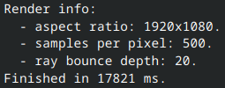
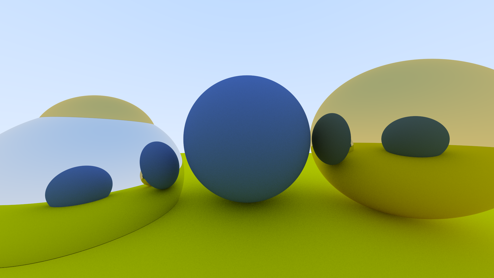
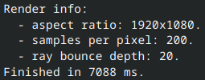

# zig_raytracer

A multithreaded path tracer written in Zig, based on the book series [Ray Tracing in One Weekend](https://raytracing.github.io/books/RayTracingInOneWeekend.html).

## Difrences from the series
- SIMD vector math for some parts
- A basic multithreaded rendering method
- PPM image output is in binary

## Example renders

All renders are done on a ReleaseFast build. The format was converted from `.ppm` to `.png` using ImageMagick, since github doesn't display `.ppm` and I'm too lazy to code a different format in. Rendered on a i7-9850H (12 threads).




Rendered with default scene at 1920x1080, 500 samples per pixel and 20 ray bounces.
Render time is ~18s.


 

Reducing the spp down to 200 gets the render time down to ~7s but with visible noise increase.

## Build Requirements

- Zig, tested on 0.17.0

## Build Instructions

```sh
zig build
```

## Usage
Run the built program at `./zig-out/bin/zig_raytracer`.

```sh
./zig-out/bin/zig_raytracer [flags]
```

Available flags:

| Flag | Shortcut | Description | Default |
|---|---|---|---|
| `--width` | `-w` | Output image width in pixels | `1920` |
| `--aspect` | `-a` | Output aspect ratio (width / height) | `1.7777777777777777` (16:9)|
| `--samples` | `-s` | Samples per pixel | `500` |
| `--depth` | `-d` | Maximum ray bounce depth | `20` |
| `--output` | `-o` | Output PPM file path | `output.ppm` |

`--help` and `--version` are also available.

Examples:

```sh
# Render the default scene with default settings
./zig-out/bin/zig_raytracer

# Render a smaller and noisier image
./zig-out/bin/zig_raytracer -w 800 -s 200 -o render.ppm

# Build and run with settings
zig build run -- -w 800 -s 200 -o render.ppm
```
